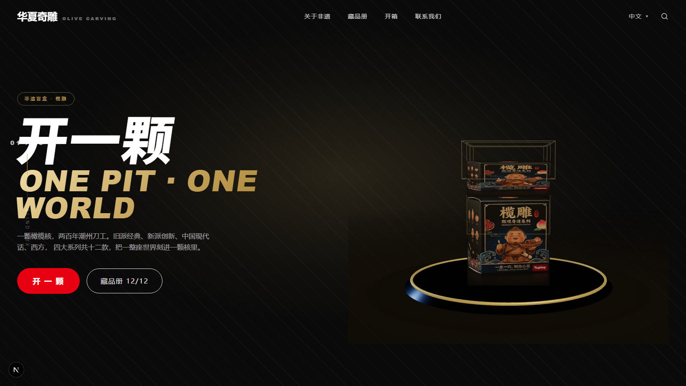

# 华夏奇雕 · 非遗盲盒 榄雕 —— 3D 开箱网站

> 一颗橄榄核，两百年潮州刀工。旧派经典、新派创新、中国现代话、西方，四大系列共十二款，把一整座世界刻进一颗核里。

一个以**榄雕（核雕）非遗**为题材的**线上开盲盒互动网站**。点一下「开一颗」，网页上演一段真 3D 的开箱仪式——**开盒 → 摇一摇 → 冒星星 → 惊喜 → 藏品升起自转**——最后把一颗榄雕藏品收入藏品册。

视觉语言参考潮玩品牌官网 [toptoyglobal.com](https://www.toptoyglobal.com/)：暗场 + 香槟金 + 中国红 + 45° 斜纹底 + 超粗斜体展示字 + 全幅首屏。




---

## 快速开始

```bash
npm install
npx next dev -p 3113
# 打开 http://127.0.0.1:3113/ ，点首屏「开一颗」
```

---

## 十二款藏品 · 四大系列

| 系列 | 编号 | 款式 | 稀有度 |
|---|---|---|---|
| **J** 旧派·经典 | J1 / J2 / J3 | 弥勒佛 / 龙舟船 / 山水 | 普通 / 普通 / 稀有 |
| **X** 新派·创新 | X1 / X2 / X3 | 吉祥象 / 蒸汽朋克机械甲虫 / 宇航员 | 普通 / 普通 / 稀有 |
| **M** 中国现代话 | M1 / M2 / M3 | 黑神话·悟空 / 福舫 / 赛博朋克城市 | 普通 / 普通 / 稀有 |
| **W** 西方 | W1 / W2 / W3 | 亚瑟王 / 耶稣 / Roblox 方块角色 | 普通 / 普通 / 稀有 |

每款都配一句「核上文案」，例如 J1 弥勒佛：「笑起来的时候，核本身的圆正好当肚子」。

---

## 开箱体验 · 五阶段

`开盒 LID → 摇一摇 SHAKE → 冒星星 STARS → 惊喜 SURPRISE → 升起·自转 REVEAL`

由 **three.js** 3D 场景 + **GSAP** 时间轴驱动：礼盒用真贴图（`public/box` 前/侧/背三面），出场藏品用真 GLB，聚光灯 + 星屑 + 光柱做「惊喜感」。落定后底部弹出**出款信息条**。

---

## 技术栈

- **Next.js 16**（App Router / Turbopack） + **React 19** + **TypeScript**
- **Tailwind CSS v4** —— 设计令牌（暗场 / 香槟金 / 中国红）
- **three.js** 0.186 —— 3D 开箱场景（GLTFLoader 载入 GLB）
- **GSAP** 3.15 —— 开箱五段时间轴
- **@lucky-canvas/react**（[buuing/lucky-canvas](https://github.com/buuing/lucky-canvas)，Apache-2.0）—— 抽奖 / 九宫格开源组件

---

## 目录结构

```
app/                    页面与全局样式（page.tsx / layout.tsx / globals.css）
components/
  site/                 首屏 Hero、关于非遗、藏品陈列架、页脚、出款条
  three/UnboxScene.ts   Three.js 3D 开箱场景
  Unbox3D.tsx           3D 舞台的 React 封装
lib/
  figures.ts            12 款 × 四大系列数据
  models.ts             GLB 模型登记表
  draw.ts               开箱抽卡逻辑
public/
  models/*.glb          12 款藏品 3D 模型
  figures/*.jpg         藏品陈列图
  box/*.png             礼盒三面贴图
```

---

## 3D 模型说明

| 来源 | 说明 | 当前覆盖 |
|---|---|---|
| 云端 image-to-3D（混元 3D） | 由参考图生成，表面光滑、有真实雕工细节 | J1 弥勒佛 |
| 自建视觉外壳（三视图剪影重建） | 从正/侧视图剪影做空间雕刻重建，轮廓正确，表面偏粗糙 | 其余 11 款 |

- 12 款 GLB 在 `public/models/*.glb`，由 `lib/models.ts` 统一登记；未登记时回退程序化「橄榄核坯」。
- 升级路径：逐款生成高质量模型并**同名覆盖** GLB 即可，无需改代码。

---

## 当前交互规则（演示版）

- 点「开一颗」**必定开出弥勒佛（J1）**（`lib/draw.ts`）。
- 藏品册进入即 **12/12 全部解锁展示**。
- 藏品册右上角有「关闭网页 ✕」按钮。

---

## 开源致谢 / 许可

- [three.js](https://github.com/mrdoob/three.js) —— MIT License
- [GSAP](https://gsap.com/) —— 遵循其标准许可
- [lucky-canvas](https://github.com/buuing/lucky-canvas) —— Apache-2.0
- 视觉语言参考 [toptoyglobal.com](https://www.toptoyglobal.com/)（**非代码依赖**，仅风格参考；品牌字标已换为自有「华夏奇雕」，不冒用他人商标）
- 12 款藏品参考图与文案：项目方提供

---

## 已知限制 / 待办

- 其余 11 款的 3D 模型质量待升级（云端 image-to-3D 有 5 次/天配额）。
- 「关闭网页」按钮受浏览器安全策略限制：仅「脚本打开的窗口」可无条件关闭。
- 当前为演示规则（必得弥勒 + 藏品册全开），可改回随机抽取 / 逐款收集。
